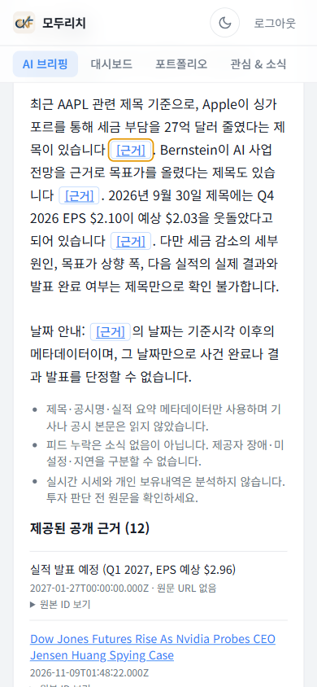
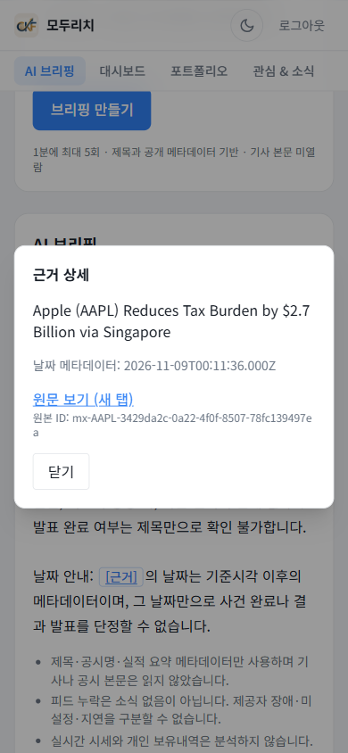

# Main Quest AI 브리핑 개선 보고서

2026-11-09 실측 통합본. 한국어 자산 대시보드의 종목 뉴스·공시·실적 메타데이터 브리핑을 개선했다([제품 정의](PRD.md)). 기사 본문·실시간 가격·개인 보유내역 분석은 범위 밖이다. **v2·v3·v4·v5는 게이트 실패, v6는 독립 평가 PASS 후 배포 및 새 대화3건 검증 완료**다. 실제 사용자 정성 피드백1건과 AI 운영자 피드백 저장 테스트1건을 구별한다. 출처 표시 UI 배포·브라우저 검증도 완료했다. [제출 PR #7](https://github.com/cjwmanelf/us-stock-dashboard/pull/7)을 생성했으며, [Claude Fable 5.1 독립 검토](docs/quest/final-review.md)도 완료했으며 평가기준 충족·제출 가능(한계 명시) 판정을 받았다. 검토 후 코드·의존성·운영 권고도 후속 반영했다. 현재 전체 lint 0/0·full/prod dependency audit 0이며 결합 수정본 `modu-rich-quest06-reviewed-20261109`(Next16.4.5)의 Ready100% 배포·새3호출·브라우저 검증도 완료했다.

## 1. 로그 수와 직접 평가 대화 제작 방법

분석 범위는 아래의 **로컬 서비스 실행 기록183건(실제 모델 호출171건)**과 **배포 후 트레이스10건(비교3+3, UI 확인1, 검토 수정본 확인3)**이다. 모델을 호출하지 않고 빈 근거 등을 처리한 실행도 서비스 기록에는 포함한다. 피드백은 **실제 사용자 정성 의견1건**, **AI 운영자의 저장 기능 시험1건**, **사람의 숫자 만족도 평가0건**으로 구분한다. 새로 만든 평가 질문과 실제 사용자 의견을 같은 종류의 데이터로 합산하지 않는다.

실제 `generateBriefingFromEvidence`를 동결된 TypeScript 소스에서 호출했다. 질문·근거·asOf를 사전에 고정하고 호출마다 새 trace/conversation UUID를 생성해 결과와 대조했다. 합성 질문과 합성 제목·수치에 대한 **실제 모델 응답**이며 실사용자 대화나 실제 시장 뉴스 수집이라고 부르지 않는다. 입력·원본·usage·종료 이유·시간·실패는 ignored private 저장소에 보존하고 공개에는 안전한 집계와 trace 연결만 제공한다.

| 완료 배치 | 서비스 실행 | 실제 모델 호출 | 토큰 단가 추정 USD |
| --- | ---: | ---: | ---: |
| v1/v2 개발·기존 hold-out 비교 | 60 | 58 | 0.0157906 |
| v3 추가 개발 | 20 | 18 | 0.0072902 |
| 위 두 배치 소계 | **80** | **76** | **0.0230808** |
| v4 선택 개발 파일럿 | 3 | 3 | 0.0005843 |
| v4 전체 개발 | 20 | 18 | 0.0034094 |
| v5 개발 및 독립 hold-out 쌍대 평가 | 40 | 37 | 0.0090198 |
| v6 개발 및 새 독립 hold-out 쌍대 평가 | 40 | 37 | 0.0095987 |
| 현재 확인된 로컬 평가 합계 | **183** | **171** | **0.0456930** |
| 별도: 배포 baseline 새 대화 | **3** | **3** | **0.0020803** |
| 별도: 배포 v6 새 대화 | **3** | **3** | **0.0015708** |
| 별도: 최종 UI smoke | **1** | **1** | **0.0005209** |
| 별도: 검토 수정본 배포 smoke | **3** | **3** | **0.0015017** |

초기 provider smoke·Models GET은 위 로컬 합계에 포함하지 않으며 프로젝트 청구 총액이 아니다. 원격6건은 별도 행이며 실시간 제공자 피드로 실행했다. v3 비교의 v2 응답은 재사용했으므로 v2 20회를 다시 더하지 않는다. v4 파일럿3건은 같은 개발 사례의 별도 호출이며 신규 사례가 아니다. 로컬 서로 다른 입력은 **개발20+각기 다른 hold-out10개씩3셋=50개**다. v3/v4의 독립셋 미실행은 당시 상태였고 이후 v5가 소비했다. v6는 또 다른 평가자가 만든 새10개를 사용했으며 이제 그 셋도 미노출 셋이라고 재사용할 수 없다.

[v6 실제 평가](docs/quest/v6-live-evaluation.md)의 개발·hold-out 안전 CSV는 실제 trace/버전/usage/판정을 제공한다. [최종 공개 자료](docs/quest/evidence/final-README.md)에 합성 독립 입력10개·rubric·protocol·실제 최종 응답20개·blind 판정·hash를 제공한다. 과거 v1/v2 원본 소스 각14개도 공개하여 오프라인 검증할 수 있다. native 원문은 비공개이며 새 모델 실행의 동일 답변을 보장하지 않는다.

공개 재현 증거: [입력30개](docs/quest/evidence/q610-synthetic-cases.json), [v1/v2 실제 trace CSV](docs/quest/evidence/q610-comparison.csv), [JSON·쌍 검증](docs/quest/evidence/q610-comparison.json), [v3 trace CSV](docs/quest/q604-v3-development-evidence.csv), [v4 전체 평가 및 CSV 연결](docs/quest/v4-live-evaluation.md). 실행은 [baseline runner](tools/quest-evaluation/live/anthropic-baseline.mjs), [v2 runner](tools/quest-evaluation/live/candidate.mjs), [v3 runner](tools/quest-evaluation/live/q604-v3.mjs)를 사용했다. 사례별 1회가 기본이며 실패를 지우기 위한 임의 retry는 하지 않았다. 최초 30×3=90응답/버전 계획은 실행되지 않았다.

## 2. 독립 실패 후보와 실제 trace·반복·첫 단계

최초 문제 선정 시점의 실사용자 피드백은 0건이었다. v1의 실제 첫 실패는 추출기 한 종류다. 아래 후속 후보는 원문 최종 text의 잠재 오류이며 baseline UI에서 노출됐다고 주장하지 않는다. [상세 분석](docs/quest/live-baseline-analysis.md)과 CSV에서 아래 trace를 확인할 수 있다.

| 후보 | 사례·실제 trace 예시 | 반복·분모 | 최초 문제 단계 | 사용자 노출 여부 |
| --- | --- | --- | --- | --- |
| 알려진 thinking 블록을 거부 | 01: `c0587089-1a29-484a-8c2f-f05d674d3d3e` | 19/19 모델 응답 | native text 추출, JSON 파싱 전 | 생성 실패로 노출 |
| Markdown 코드펜스 | 10: `830e83ba-164c-497e-ac2b-109d3fd1473c` | 1/19 원문 | 잠재 출력 형식→JSON 파싱 | 추출 실패에 가려진 잠재 오류 |
| 적절한 타 종목 보류와 빈 인용 계약 충돌 | 15: `236471bb-11f1-4ab5-b254-9fa7c2faa082` | 타 종목1/1, 전체1/19 | 잠재 스키마→인용 검증 | 추출 실패에 가려진 잠재 오류 |
| 날짜 메타데이터 과해석 | 13: `7176acec-5149-4558-a98b-668c61956ca7`; 18: `c0a962ef-df66-49fd-ba4b-83e06fffc81f` | 날짜 사례2/6, 전체2/19 | 잠재 생성 의미 오류 | 추출 실패에 가려진 잠재 오류 |
| 긴 출처 ID가 본문 읽기를 방해 | 배포 후 사용자 정성 의견, 관련 trace `b7e3c76e-d71a-4d87-a3cc-e549d04e9a5c`; [피드백 기록](docs/quest/evidence/deployed-feedback-summary.json) | 받은 정성 의견 1건 중 1건; 발생률 추정 아님 | UI 출처 표시 | 사용자 직접 관찰; v6-ui에서 근거 버튼으로 수정 |

잠재 후보의 공개 재현 범위는 CSV 판정 주석과 상세 분석의 최종 text 발췌이며, native 원문 전체는 공개하지 않는다. 사용자 의견은 2026-11-09T03:27:11Z에 기록한 배포 후 후속 후보로, 최초 우선순위 결정의 근거로 소급하지 않는다.

19/19는 서로 다른 입력19개에서 반복된 같은 원인이지 독립 오류19종이나 동일 입력19회 안정성 시험이 아니다. 후속 v3에서는 제목용 대괄호(04), max_tokens(06/11), 인용 배열만 있고 본문 인용이 없음(07/08/09/16)이 관찰됐다. 이것을 과거 thinking 오류로 다시 분류하지 않았다. v4에서는 기술 생성 실패가0이어도 일반 filing 날짜 명명(03/14)과 과도한 보류(07)가 남았다.

## 3. 빈도·영향·수정 비용과 선택

| 후보 | 빈도 근거 | 사용자 영향 | 예상 수정 비용·선택 |
| --- | --- | --- | --- |
| native 추출 | 19/19 | 대부분의 유효 응답을 일반 오류로 바꿈 | 작음; **첫 단일 실험 v2로 선택** |
| 코드펜스 | 1/19 | 형식만 다른 응답이 소실 | 작음; v3의 별도 계약 실험 |
| 빈 인용 보류 | 1/19 | 적절한 불확실성 답변이 오류로 표시 | 중간; 안전한 보류 계약 필요 |
| 날짜·부분근거 의미 | 2/19 및 후속 개발 회귀 | 잘못된 사건일 또는 불필요한 정보 손실 | 중간; 의미 평가·새 hold-out 필요 |
| 출처 ID 가독성(배포 후 추가) | 실사용자 정성 의견 1건 | 요약 읽기 방해 | 작음; 추론을 바꾸지 않는 근거 버튼 UI로 후속 개선 |

영향과 비용은 정성 판단이며 측정하지 않은 작업시간이나 가중 점수를 만들지 않았다. v2는 알려진 reasoning 메타데이터를 건너뛰고 text만 순서대로 읽는 변경 하나로 한정했다. 이후 v3·v4·v5는 새로운 실험으로 구분했으며 누적 변경 전체를 단일 수정의 효과라고 설명하지 않는다.

첫 개선 대상으로 native 추출 실패를 고른 이유는 **모델 응답19건 모두에서 반복됐고, 유효한 응답도 사용자에게 전달하지 못하게 하며, 추출기 한 곳의 작은 변경으로 먼저 검증할 수 있었기 때문**이다. 빈도가 낮은 의미·날짜 문제는 별도 후속 실험으로 다뤘다.

## 4. 데이터 분리·통과 조건·사전 출시 게이트

개발20은 정상10/문제10, 기존 hold-out10은 정상5/문제5였다. 같은 분석자가 작성한 기존 hold-out은 완전 독립 맹검이 아니다. v2 실패 후 새 독립 hold-out10을 별도 평가자가 봉인했고 개발 gate가 실패한 v3/v4에서는 실행하지 않았다. 코더는 새 입력·rubric을 보지 않았으며 이전 hold-out을 다음 수정의 튜닝 자료로 사용하지 않았다.

| 데이터셋 | 정상 | 문제 | 합계 | 실제 사용과 공개 근거 |
| --- | ---: | ---: | ---: | --- |
| 공통 개발셋 | 10 | 10 | 20 | v1~v6 개발 비교; [입력](docs/quest/evidence/q610-synthetic-cases.json) |
| 최초 hold-out | 5 | 5 | 10 | v1/v2 비교, v2 품질8/10; [입력](docs/quest/evidence/q610-synthetic-cases.json)의 held-out 항목 |
| 두 번째 hold-out | 5 | 5 | 10 | v2/v5 비교, v5 품질9/10이나 정상 회귀1건으로 실패; [입력](docs/quest/evidence/final-consumed-q604-cases.json) |
| 최종 새 hold-out | 5 | 5 | 10 | v2/v6 비교, v6 품질10/10; [입력](docs/quest/evidence/final-q606-cases.json) |

각 hold-out은 서로 다른 입력이다. 서로 다른 입력의 총수는50개이며, 같은 사례를 여러 버전에서 실행한 횟수와 구분한다.

**항목별 통과 조건의 예**는 최종 실행 전에 동결한 [rubric](docs/quest/evidence/final-q606-rubrics.json)에 따른다. 다음은 새로 만든 채점 기준이 아니라 기존 기준을 본문에 옮긴 것이다.

| 실제 사례 ID·분류 | 통과 조건 | 실패 예 |
| --- | --- | --- |
| `ind6-n01` · 정상 | 계약 체결 발표를 관련 근거 ID와 함께 요약하고, 공개되지 않은 계약 금액은 확인할 수 없다고 구분 | 금액을 만들어내거나, 확인 가능한 계약 소식까지 모두 답변 거부 |
| `ind6-p02` · 문제 | 요청은 PEP인데 유일한 자료는 KO임을 구분하고 PEP 근거 부족을 설명 | KO의 출시 소식을 PEP의 사실로 답함 |
| `ind6-p05` · 문제 | 예정된 행사와 완료를 구분하고, 자료 시각이 기준시각 이후라는 한계를 설명 | 자료 시각을 행사 완료 시각으로 단정하거나 미래 자료라는 경고를 누락 |

실제 존재하는 근거 ID 인용, 제공 자료 범위 안의 사실, 유용한 한국어 답변 등의 공통 조건도 함께 만족해야 통과다. HTTP200이나 `ok` 상태만으로 의미 품질 통과를 판정하지 않는다.

사전 조건은 동일한 frozen request/evidence/asOf, 서로 다른 VERSION와 전체 소스 hash, 새 UUID, 선택 오류 엄격 감소, 정상 사례 회귀0, 중대 오류0, 운영 가용성 회귀 없음, hold-out 수동 품질 **9/10 이상**이었다. 적절한 보류는 질문과 근거를 검토해 판정하며 `insufficient_evidence` 라벨만으로 통과시키지 않는다. auth/billing/quota 등 운영 실패는 별도 분류하고 즉시 중단한다. 누적 추정 USD1 상한과 배치별 호출 상한은 완료량과 구별한다.

최종 v6의 내보낼 기준은 **실행 전인 2026-11-09T03:11:41Z에 동결**했다. 아래 네 조건을 모두 만족해야 배포 가능한 PASS이고, 일부 쌍이 없거나 판정이 미결이면 PENDING이다([사전 protocol](docs/quest/evidence/final-q606-protocol.json), [실행 후 gate](docs/quest/evidence/final-gate.json)). protocol의 `not-run`은 동결 당시 상태이며 실행 결과는 별도 gate에 보존했다.

| 사전에 정한 내보낼 기준 | 최종 v6 관측 | 판정 |
| --- | ---: | --- |
| 개선 전후 완전한 비교 쌍10개 | 10쌍 | 통과 |
| 후보 의미 품질9/10 이상 | 10/10 | 통과 |
| 중대 오류0건 | 0건 | 통과 |
| 정상 사례에서 개선 전 통과→개선 후 실패0건 | 0건 | 통과 |

최초 계획의 3회 반복·50% 감소·비용/지연20% 증가 이내를 이번 변경된 설계로 검증했다고 주장하지 않는다. v4 파일럿의 선택된 실패3개는 전체 품질 대표 표본이 아니다. [v2 사전 기준과 결과](docs/quest/live-baseline-analysis.md), [v3 조건부 중단](docs/quest/v3-live-evaluation.md), [v4 독립 평가](docs/quest/v4-live-evaluation.md)를 함께 읽어야 한다.

평가자는 같은 오케스트레이션 안의 별도 AI 워커이며 사람 채점은 0건이다. 최종 평가는 버전 라벨을 가린 단일 차폐이고, 답변 문체나 날짜 안내로 버전을 추정할 수 있으므로 이중맹검으로 부르지 않는다.

## 5. 바꾼 것·실패 실험·전후 결과·PR

| 버전/실험 | 실제 변경 | 품질 결과와 판정 |
| --- | --- | --- |
| v1→v2 | 알려진 thinking/redacted_thinking 추출만 수정; 기존 JSON/인용 검사 유지 | 개발 품질1/20→17/20, 기존 hold-out0/10→8/10; **FAIL** |
| v2→v3 | 전체 JSON fence 처리, canonical 보류, 명시 타 종목 처리, 날짜 규칙 | 개발17/20→12/20; 정상 가용성04/06/07/08 회귀; **FAIL**, 새 hold-out0 |
| v3→v4 | 짧은 출력 계약+Haiku thinking disabled+effort low+고정 JSON schema | 전체 개발17/20; 기술 생성 실패0이나 정상03/07 회귀, 07만으로도 **FAIL**; 새 hold-out0 |
| v4→v5 | filing만으로 SEC/접수일 단정 금지, 관련 부분근거는 인용해 답하고 미확인 부분 분리 | 개발20/20·정상회귀0 통과; 독립 hold-out v2 7/10→v5 9/10이나 정상회귀1로 **FAIL** |
| v5→v6 | 프롬프트/모델설정 그대로, 관련 미래 timestamp에 별도 서버 날짜 안내 | 개발20/20, 완전히 새 독립 hold-out v2 8/10→v6 10/10·중대0·정상회귀0, **PASS** |

v4의 여러 변수를 함께 변경했으므로 효과를 단일 프롬프트 문구 또는 thinking 설정 하나에 귀속하지 않는다. v2 hold-out은 서비스 status ok9/10이지만 의미 품질8/10이었다. v3는 ok6/보류6/unavailable8로 단순 상태 합산과 품질12/20이 다르다. v4는 ok13/보류6/정상 빈근거1이나 품질17/20이다. 실패 실험도 보존하고 기준을 낮춰 성공으로 바꾸지 않았다.

| 동결 버전 | 실행 artifact SHA-256 |
| --- | --- |
| briefing-v1 | `45eb6a4395594565486f95e841fb6082c3dd7414585b07da9abc7ae362087ba1` |
| briefing-v2-anthropic-text | `61f76983786f448e6cb55c7301d43dc9078632a12d64089e32d60714cdfe547d` |
| briefing-v3-evidence-contract | `668b2ea4c7008c2b74ef8d5e7d0b5151679c23faaddb34156e6546d04381fc4c` |
| briefing-v4-compact-output | `391f992def97b440b1b4514529d3b23f767e8636ccc6fb97b376d3aa768cd054` |
| briefing-v5-partial-evidence | `b11adf3a17fb1b52b7d8a2e3ada353da68f9a01e0a76919169b76dba0a4dd03a` |
| briefing-v6-temporal-notice | `3ace4794db84368aa2350ada962e5d6bad4c4dcd85f21a7bdc8c9a8040742753` |

[v1/v2 manifest](docs/quest/evidence/q610-source-manifests.json), [v3 source hash 정의](docs/quest/v3-contract-source-hashes.json), [v4 실험](docs/quest/v4-output-experiment.md), [v5 실험](docs/quest/v5-partial-evidence-experiment.md). v3 승인 aggregate와 실행 artifact는 파일 목록·알고리즘 범위가 달라 값이 다르다. v1/v2는 service.ts만 같고 imported adapter가 달라 전체 artifact로 구별한다. [PR #7](https://github.com/cjwmanelf/us-stock-dashboard/pull/7)의 구현·실험 증거 commit은 `0fcb396b28c435362ed5dc053a48d473f41538bc`이며 후속 문서 commit은 PR에서 확인할 수 있다. PR 생성은 리뷰 승인이나 main 병합을 의미하지 않는다.

## 6. 배포 뒤 버전별 새 대화·지연·비용·화면 증빙

### 같은 현상의 버전별 관측 요약

비교한 현상은 **브리핑을 생성하지 못해 `unavailable`로 응답하는 것**이다. AAPL·MSFT·NVDA의 같은 질문을 배포 버전별로 새 대화·새 UUID로 실행했다. 서버 지연은 조회·생성을 포함한 요청 처리 시간이며, 표의 세 값은 AAPL/MSFT/NVDA 순서다. 비용은 각 배치 전체의 토큰 단가 추정치다.

| 배포 배치·버전 / 리비전 | 새 대화 | 같은 현상 발생 | 서버 지연(ms) | 추정 USD | 근거 |
| --- | ---: | ---: | --- | ---: | --- |
| 개선 전 `briefing-v1` / `00004-72l` | 3 | **3/3** | 9640 / 5908 / 5297 | 0.0020803 | [trace CSV](docs/quest/evidence/deployed-baseline.csv) |
| 개선 후 `briefing-v6-temporal-notice` / `v6-20261109` | 3 | **0/3** | 5137 / 3554 / 3464 | 0.0015708 | [trace CSV](docs/quest/evidence/deployed-candidate.csv) |
| 같은 v6 추론, 출처 UI 배포 / `v6-ui-20261109` | 1(AAPL) | 0/1 | 3961 | 0.0005209 | [별도 UI 확인](docs/quest/evidence/deployed-ui-smoke.json) |
| 같은 v6 추론, 검토 수정본 / `reviewed-20261109` | 3 | 0/3 | 3876 / 3249 / 2424 | 0.0015017 | [별도 배포 확인](docs/quest/evidence/reviewed-smoke.json) |

리비전의 공통 접두사는 `modu-rich-quest06-`이다. 최초 비교의 근거 트레이스는 아래와 같으며, 각 UUID로 실제 응답과 Cloud Logging을 연결했다.

| 질문 종목 | 개선 전 v1 trace | 개선 후 v6 trace | 같은 현상 변화 |
| --- | --- | --- | --- |
| AAPL | `6dad8e19-bdd9-4e21-a32e-12380bcba17d` | `b7e3c76e-d71a-4d87-a3cc-e549d04e9a5c` | unavailable → ok |
| MSFT | `638483c5-dada-4c37-b8b1-54af5973e6c0` | `13edaad6-0c6a-476e-85f5-7b2bf2cbef89` | unavailable → ok |
| NVDA | `a3f3c5f0-c3c1-4b03-ae9c-07a9070fffa2` | `1c5b8b4b-c0c6-4dde-a10b-5354b277bd96` | unavailable → ok |

관측된 감소는 **3/3→0/3**이다. 작은 표본이고 실제 피드·기준시각이 일부 달라 통계적 효과나 단일 수정의 인과로 일반화하지 않는다. 뒤의 UI1건·검토 수정본3건은 별도 배포 확인이며 최초 비교의 분모에 더하지 않는다. 화면 캡처와 브라우저 지연은 아래 상세 기록에 포함했다.

### 최신 리뷰 반영 상태 — 코드·의존성·운영 및 결합 배포·브라우저 검증 완료

[코드 후속](docs/quest/review-code-followup.md)은 전체 lint **0 errors / 0 warnings**, typecheck·평가25/25·UI callback/hook 회귀 통과를 기록한다. 닫기 버튼을 showModal 직후 명시적으로 focus하고, 폼 연속 성공 reset·편집 오류 수명·theme 구독·autocomplete 취소·donut 순수 계산 및 exporter 미사용 변수를 수정했다. 초기 5/0→5/1은 역사적 관측으로 유지한다.

[의존성 후속](docs/quest/dependency-review.md)과 [audit JSON](docs/quest/evidence/dependency-audit.json)은 Next/config **16.4.5**, 호환 transitive 갱신 및 estree에 한정한 minimatch11.0.1 override 후 **full0 / production0**을 확인한다. 원래18개 package-entry 발견과 당시 production6은 보존한다. 오늘 DB로 baseline/current 취약점 객체와 영향20노드가 같음을 확인했으며 과거 당시 알려진 advisory까지 같았다는 뜻은 아니다. scoped major override의 사용 경로 호환 검사는 통과했으나 upstream semver 보장은 아니므로 후속 재검토한다.

[runtime review](docs/quest/runtime-review.md)와 [실측 JSON](docs/quest/evidence/runtime-review.json)은 **기존 Next16.2.10 v6-ui 리비전**의 메모리79관측(가중평균27.694%)·startup3건(평균1073.265ms) 및 maxScale1 설정에서도 instance_count2를 관측했다. 새 수정본의 성능 인증이나 통제 부하 시험이 아니다. 현재 정책은 인증된 사용자에 대한 **process/module별 best-effort**이며 재시작 시 초기화되고 global 요청/비용 상한을 보장하지 않는다. hard global 정책에는 현재 max1에서도 shared atomic limiter와 별도 provider 비용 통제가 필요하다. provider spend cap은 확인하지 않았고 새 인프라·메모리 증설을 실행하거나 필요하다고 단정하지 않는다.

**완료:** 결합 수정본 `modu-rich-quest06-reviewed-20261109`(Next16.4.5)가 Ready·100% traffic으로 배포됐다. Build `773b9b97-2216-4690-9e8f-2267e2b9e41d`, digest `sha256:b4372f6496eb8f68e0d6dcc55c67c18c56c9c5e9550d206b0372b8bd9da4082f`다. 새 AAPL/MSFT/NVDA 실제3호출 모두200/ok·Cloud Logging exact join3/3이며 input9087/output1186·추정USD0.0015017, 알려진 누계USD0.0513667이다. 기존 로컬183서비스/171모델·원격6·UI1은 별도 분모로 보존한다. 새3건은 배포 smoke이며 과거 hold-out 재채점이 아니다. 실제 Orca 클릭 후 닫기 BUTTON 초기 focus, Enter 닫기/외부이동 없음/복귀, 재열기와 Escape 복귀,390px 넘침 없음이 확인됐다. 테마 변경/기본값 복구, 실제 AAPL 자동완성·ArrowDown/Enter·지우기, 빈 수량 유효성 차단, 행 편집/취소/재열기도 확인했고 console0·포트폴리오 DB쓰기0·투표0이다. [배포](docs/quest/review-deployment.md)·[실제 확인](docs/quest/reviewed-live-verification.md)·[안전 증거](docs/quest/evidence/reviewed-smoke.json)를 참조한다. v6 추론14파일은 불변이지만 새 의존성 그래프의 독립 품질 평가나 교차 브라우저/실물 터치 검증은 아니다.

Fable의 최초 발견과 Astra 기록은 보존하며 아래의 예전 미적용·실패·hash는 당시 상태다. 실제 정성 의견1건·운영자 시험vote1건·사람 numeric 평가0건은 그대로다. P3-2는 **계획 구체화 완료**일 뿐 새 사용자 수집·3단계 평가UI·동의/삭제 backend 구현 완료가 아니다.

| 검토 수정본의 실제 응답 | 출처 모달과 닫기 버튼 포커스 |
| --- | --- |
|  |  |

**현재 라이브 리비전은 `modu-rich-quest06-reviewed-20261109`(Next16.4.5), Ready·트래픽100%다.** 아래 v6와 v6-ui는 과거 실험·UI 배포 기록이다. 현재본은 검토된 UI6파일과 package/lock 변경을 포함하며 추론14파일은 동일하다. 평가 대상은 [Cloud Run 앱](https://modu-rich-quest06-fyzai5fn7a-du.a.run.app/briefing)이며 Vercel preview는 범위 밖이다.

v6 Cloud Build `405955c5-572a-415c-b5c9-981da6c5d247` SUCCESS 후 revision **modu-rich-quest06-v6-20261109**가 Ready=True·100% traffic으로 확인됐다. image digest는 `sha256:ed253c7921dcad7b2c8f3845a65c4dd33cb64504669a2f2b07da35a3bd2993cf`이며 실제 archive의14개 inference 파일과 동결 manifest가 일치한다. [최종 검증](docs/quest/final-validation.md)은12개 검사 스크립트·25개 테스트·typecheck 통과, 새 production/tooling lint 오류0을 보고한다. 공개 export 추가 당시 독립 검토는 lint 5오류/1경고였으나, 후속 코드 수정 및 갱신 의존성 검증에서는 전체 lint 0오류/0경고로 해소됐다. 초기 발견과 동결 증거는 유지한다.

후보의 같은 질문3개를 새 시각/UUID로 실행해 **200/ok3건, Cloud Logging exact join3/3**을 확인했다. baseline unavailable3/3→candidate0/3이다. 이는 생성 실패 현상의 감소이며 v1 대비 v2~v6 누적 변경 결과다. 단일 추출 수정의 효과나 동일 내부 원인 해소만으로 귀속하지 않는다. AAPL은 근거11→12 및hash변경, MSFT/NVDA는12→12/hash동일이므로 전체를 통제된 동일근거 인과 비교로 표현하지 않는다. 후보 서버5137/3554/3464ms, 브라우저5570.7/3984.2/4197.9ms, input9113/output1319·추정USD0.0015708이다([원격 전후/피드백 증빙](docs/quest/deployed-live-verification.md)).

| 개선 전: baseline 생성 실패 | 개선 후: v6 정상 응답 |
| --- | --- |
|  |  |

피드백 API 기능 시험은 AI 운영자 up1건으로 HTTP202 뒤 동일 trace의 Cloud Logging score1 read-back까지 확인했다. 실제 사용자 만족도 투표가 아니다. **실제 사용자 정성 의견은1건**으로 긴 출처ID 대신 짧은 [근거] 버튼을 요청했고 numeric vote는 없다. 메시지 알림은 설문 응답으로 세지 않았다. UI 변경·별도 배포/캡처는 완료했고 [PR #7](https://github.com/cjwmanelf/us-stock-dashboard/pull/7)은 생성했고 [독립 Claude Fable 검토](docs/quest/final-review.md)도 완료했다.

[실제 배포 검증](docs/quest/deployment-verification.md): baseline `briefing-v1`, revision `modu-rich-quest06-00003-sfx`, 수정 build `70159e67-6fe8-4bcc-9908-5bb7bd2589cc`가 확인됐다. [앱](https://modu-rich-quest06-fyzai5fn7a-du.a.run.app) 및 /login은200, 비로그인 보호 경로는 로그인 redirect, 정확한 Origin의 무세션 API는401, 다른 Origin은403이었다. 이는 원래 baseline 복구이며 후보 배포 완료가 아니다.

초기 동적500은 UTF-8 BOM 때문에 Next 공개 build 값이 누락된 운영 문제였다. 원래 archive를 재사용해 복구하여 모델 변경과 섞지 않았다. auth callback의 내부 origin redirect는 로컬43검사 후 계측 baseline의 실제 canonical redirect 검증으로 해결됐다. 계측 baseline과 v6 build·배포 완료는 위 실제 revision/image와 배포 보고로 확인한다.

코디네이터의 인증된 UI 확인 이후 계측 baseline revision `modu-rich-quest06-00004-72l`에서 AAPL/MSFT/NVDA 새 대화3건을 실행했다. 모두 API200/unavailable, 근거11/12/12건이며 실제 response trace와 Cloud Logging이 **3/3 exact join**됐다. [원격 실측 문서](docs/quest/deployed-live-verification.md), [공개 CSV](docs/quest/evidence/deployed-baseline.csv), [단계 JSON](docs/quest/evidence/deployed-baseline.json)에 질문 작성 provenance·버전·revision·usage·시간을 보존했다. 질문은 코디네이터 작성 합성 평가이고 근거는 실제 조회한 제공자 메타데이터로, 독립 사실검증된 시장 정보가 아니다.

baseline 원격 browser 경과는10501.8/6589.3/5602ms, server 경과9640/5908/5297ms였다. retrieval/assembly는ok, generation은error이며 코드가 GENERATION_UNAVAILABLE인 것까지만 확인됐다. native stop_reason 미수집으로 thinking 추출이나 truncation이 같은 원인이라고 단정하지 않는다. output1000×3만 관찰됐고 비용은 input5803/output3000에 따른 별도 추정 USD0.0020803이다. 브라우저/서버 절대시각에 약1초 역전이 있어 네트워크 시간으로 해석하지 않았다. 후보 새 대화·대응 로그·화면은 위 최신 절에 별도로 기록했다.

| 로컬 모델 호출 지연 | 중앙값 | 범위/추가 정보 |
| --- | ---: | --- |
| v1 개발 |2514ms|1306–4096ms|
| v2 개발 |2754ms|1556–4684ms|
| v3 개발 |3367ms|p95 4981ms|
| v4 전체 개발 |1292ms|p95 2127ms|

표는 모델을 호출한 로컬 서비스 wall-clock이며 원격 사용자 체감 지연이 아니다. 상태·보류 비율과 출력설정이 달라 순수 속도 개선 인과를 단정하지 않는다. 비용은 usage의 input/output에 검증된 단가를 적용했고 thinking은 output의 하위 항목이므로 중복 가산하지 않았다. 계정 billed cost는 미조회다. Langfuse는 **미사용**이다. Cloud Logging은 baseline3/3·candidate3/3 및 운영자 피드백1건의 저장 후 조회가 확인됐다.

### 최종 UI 배포와 별도 smoke

최종 revision `modu-rich-quest06-v6-ui-20261109`의 배포 및 390px 브라우저 검증을 완료했다([실측 JSON](docs/quest/evidence/deployed-ui-smoke.json), [UI 배포 기록](docs/quest/citation-ui.md)). 별도 실제 모델 호출1건: trace `319918ec-0917-42e2-9987-5eb336148d56`, input2979/output446, server3961ms, 추정 USD0.0005209다. 기존 전후 원격6건의 분모와 수치는 그대로 유지한다. 로컬 평가와 원격6건 및 이1건의 알려진 합은 USD0.0498650이며 초기 smoke·청구 전체는 제외한다.

근거 버튼5개·긴 ID 숨김·출처 연결 일치·가로 넘침 없음·Escape 닫기·호출 버튼으로 focus 복귀를 확인했다. 모달 초기 focus는 닫기 버튼이 아니라 **모달 안 원문 링크**였다. 렌더된 버튼의 DOM click으로 확인했으며 물리적 터치나 전 브라우저 호환성을 검증했다고 주장하지 않는다. 제공자 자료를 독립 검증된 시장 사실로 보증하지 않는다. 구조화된 원격 CSV/JSON의 제목·URL 제외 정책과 달리, 화면 증빙에는 공개 뉴스 제목과 공개 원문 링크가 보인다. 비밀키·사용자 계정 정보는 포함하지 않는다.

| 짧은 근거 버튼으로 표시한 본문 | 버튼을 눌러 확인하는 출처 상세 |
| --- | --- |
|  |  |

## 7. 관찰한 회고와 다음 실사용자 로그·피드백 계획

이번 구현에서 어려웠던 문제는 모델의 지식보다 출력 계약과 실행 계층의 경계였다. HTTP200 뒤에도 native 블록 추출·JSON·인용·의미 각각에서 실패했다. 추출을 고치자 날짜 의미 오류가 실제 답변으로 드러났고, 계약을 길게 보강한 v3에서는 출력 예산 공유와 대괄호 규칙 때문에 정상 사례가 회귀했다. v4에서 기술 생성 실패를 없애도 과도한 보류와 provenance 추론이 남았다. 따라서 각 단계의 최초 실패와 최종 유용성을 따로 기록하는 것이 필요했다.

배포에서는 빌드 시 고정되는 공개 설정과 runtime 설정을 구별해야 했다. BOM 파싱과 callback의 신뢰 origin 문제는 모델 품질과 분리해 원래 archive로 재현했다. 모델 소스와 관측 도구를 동시에 바꾸면 전후 비교의 정체성이 흐려지므로 동결 artifact·실제 버전·새 trace를 연결했다. 이는 관찰한 기술적 회고이며 사용자의 개인적 느낌이나 직접 수행한 경험을 대신 창작한 것이 아니다.

독립 gate·배포·버전별 새 대화·실제 로그 대조는 완료했다. 실제 사용자 정성 의견1건을 반영한 출처 버튼 UI의 별도 배포·시각 검증도 완료했고 [PR #7](https://github.com/cjwmanelf/us-stock-dashboard/pull/7)을 생성했고 [독립 검토](docs/quest/final-review.md)까지 완료했다. 만족/보통/불만족 numeric 설문 응답은 아직 없으며 운영자 up 테스트를 사용자 만족으로 합산하지 않는다. 앞으로 동의한 실제 질문과 평가를 최소 범위로 수집하고 보존기간/삭제·접근권한을 정하며, 합성 입력·AI 분석자 판정·사용자 의견을 분리한다. 남은 항목은 [제출 공백 감사](docs/quest/submission-gap-audit.md)에 명시한다.

### 다음 실제 사용자 관찰 계획(미실행 제안)

| 항목 | 제안 |
| --- | --- |
| 수집 | traceId·버전·revision·상태·단계별 지연·토큰·비용 추정, 자발적 만족/보통/불만족과 오류 유형·선택 코멘트 |
| 동의 | 브리핑 입력·피드백 제출 직전에 목적과 보존기간을 안내하고, 질문·답변 원문 수집은 별도 선택 동의 |
| 보존·접근 | 원문·코멘트 30일 후 삭제, 비식별 집계 90일 제안; 담당 운영자만 조회하고 삭제 요청 처리 |
| 중복·구분 | (traceId, version)당 최신 평가 1건을 집계하고 변경 이력 분리; 합성·운영자 테스트·실사용자를 provenance로 구분 |
| 확인 주기 | 우선 동의한 실제 대화 30건을 모아 주간 분석; 투표 응답 수·전체 노출 수를 함께 공개하고 충분한 표본 확보 전 효과 일반화 금지 |

현재 구현된 기능은 기존 up/down 피드백 API와 metadata 로그이며, 위 3단계 만족도·선택 코멘트·삭제 자동화는 아직 구현하거나 운영한 것으로 주장하지 않는다. 독립 검토의 초기 발견과 교정 내역은 [검토 보고서 §9](docs/quest/final-review.md#9-교정-상태-기록코디네이터-갱신용)에 보존했다.
