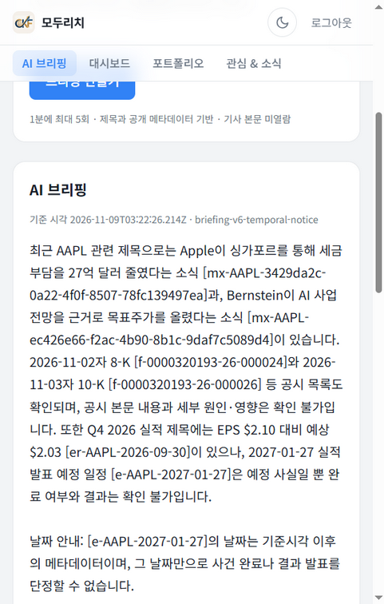
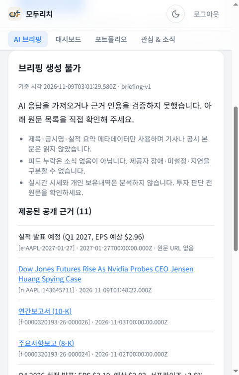
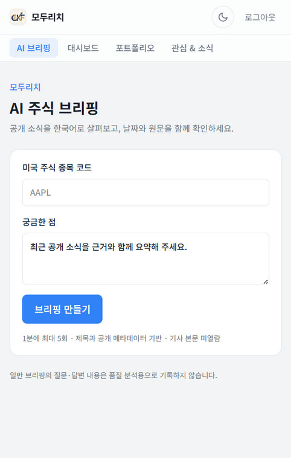
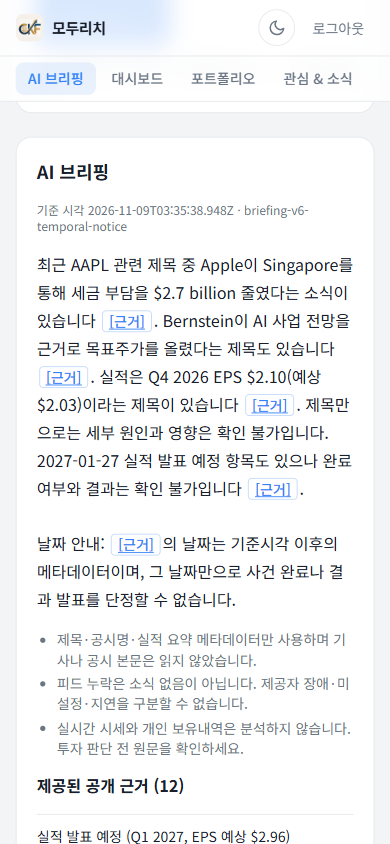
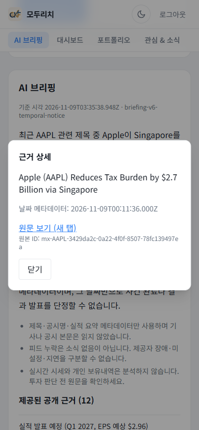

# 배포 후 새 대화 검증 — baseline·v6 각3건 완료

## 최신 후속 — 검토 수정본 배포 확인

**완료:** 결합 수정본 `modu-rich-quest06-reviewed-20261109`(Next16.4.5)가 Ready·100% traffic으로 배포됐다. Build `773b9b97-2216-4690-9e8f-2267e2b9e41d`, digest `sha256:b4372f6496eb8f68e0d6dcc55c67c18c56c9c5e9550d206b0372b8bd9da4082f`다. 새 AAPL/MSFT/NVDA 실제3호출 모두200/ok·Cloud Logging exact join3/3이며 input9087/output1186·추정USD0.0015017, 알려진 누계USD0.0513667이다. 기존 로컬183서비스/171모델·원격6·UI1은 별도 분모로 보존한다. 새3건은 배포 smoke이며 과거 hold-out 재채점이 아니다. 실제 Orca 클릭 후 닫기 BUTTON 초기 focus, Enter 닫기/외부이동 없음/복귀, 재열기와 Escape 복귀,390px 넘침 없음이 확인됐다. 테마 변경/기본값 복구, 실제 AAPL 자동완성·ArrowDown/Enter·지우기, 빈 수량 유효성 차단, 행 편집/취소/재열기도 확인했고 console0·포트폴리오 DB쓰기0·투표0이다. [배포](review-deployment.md)·[실제 확인](reviewed-live-verification.md)·[안전 증거](evidence/reviewed-smoke.json)를 참조한다. v6 추론14파일은 불변이지만 새 의존성 그래프의 독립 품질 평가나 교차 브라우저/실물 터치 검증은 아니다.

아래 과거 실험·초기 focus·해시·smoke는 당시 증거로 보존하며 최신 상태를 대체하지 않는다.

## v6 최종 원격 결과와 피드백 구분

후보 revision **modu-rich-quest06-v6-20261109**는 Ready=True,100% traffic이며 image digest는 `sha256:ed253c7921dcad7b2c8f3845a65c4dd33cb64504669a2f2b07da35a3bd2993cf`다([배포 검증](deployment-verification.md)). 실제 새 대화3건 모두 API200/status ok이고 response trace와 Cloud Logging exact join은3/3이다. baseline 일반 생성실패는3/3, 후보는0/3이다. 이는 현장 동작 확인이며 실사용 정확도100% 보증은 아니다.

| 종목 | 후보 trace | 근거 수 | server/browser ms | retrieval/assembly/generation ms |
| --- | --- | ---: | --- | --- |
| AAPL |b7e3c76e-d71a-4d87-a3cc-e549d04e9a5c|12|5137 /5570.7|1919 /0 /3217|
| MSFT |13edaad6-0c6a-476e-85f5-7b2bf2cbef89|12|3554 /3984.2|904 /0 /2650|
| NVDA |1c5b8b4b-c0c6-4dde-a10b-5354b277bd96|12|3464 /4197.9|997 /0 /2467|

후보 단계는 모두ok다. [후보 CSV](evidence/deployed-candidate.csv), [후보 단계 JSON](evidence/deployed-candidate.json), [전후 대응 JSON](evidence/deployed-comparison.json)에서 원본 실제 시각·버전·trace·usage를 확인할 수 있다. 질문3개는 baseline과 정확히 같고 trace는 모두 새 UUID다. **AAPL은 근거11→12, hash도 변경**됐고 MSFT/NVDA는12→12이며 근거 hash가 같다. asOf·실행시각은 새로 생성됐으므로 전체를 동일 frozen evidence의 단일변수 인과 실험이라고 부르지 않는다.

후보 input9113/output1319로 단가 추정은 **USD0.0015708**이다. baseline USD0.0020803과 합한 원격6건은 **USD0.0036511**이며 로컬 평가 누계USD0.0456930과 별도다. 알려진 두 묶음의 합USD0.0493441은 초기 smoke·계정 청구 전부를 포함하지 않는다. native stop_reason은 원격 양쪽에서 수집되지 않았고 output 토큰만으로 원인을 확정하지 않는다.

### 피드백 저장 검증과 실제 사용자 의견은 다른 자료

AAPL 후보 trace에 대해 **AI 운영자 기능 테스트**가 up/score1을 제출해 HTTP202/accepted를 받았다. 당시 delivery는 stdout_written_unverified였으나, 이후 Cloud Logging에서 같은 trace/version의 briefing_feedback1건과 score1을 확인해 실제 read-back을 검증했다. 이것은 사용자 만족도 투표가 아니다([안전한 피드백 요약](evidence/deployed-feedback-summary.json)).

별도로 **실제 사용자 정성 의견1건**이 도착했다: 긴 출처 ID가 읽기를 방해하므로 짧은 [근거] 버튼으로 상세 출처를 열어 달라는 요청이다. numeric vote는 없으며 만족도 점수로 환산하지 않는다. 메시지 도착 알림 자체는 설문 응답에서 제외했다. 원문 메시지는 비공개로 유지하고 요청 취지만 요약했다. 표시 UI의 별도 배포·브라우저 확인·스크린샷은 완료했으며 독립 Claude Fable 검토도 완료됐다([초기 독립 판정과 교정 기록](final-review.md)). backend v6의 동결 실험 결과를 UI 수정의 재실험처럼 중복 집계하지 않는다.

아래 baseline 기록은 원형을 보존한 역사적 결과이며 candidate 대기 문구는 이 최신 절로 대체된다.

2026-11-09 코디네이터가 인증된 브라우저 세션에서 직접 작성한 평가 질문3개를 실행했다. 질문은 합성이지만 근거는 배포 앱이 조회한 공개 피드 제공자 메타데이터다. 로컬 합성 근거 benchmark와 다르며, 제공자 제목·수치의 시장 사실성을 독립 검증한 것은 아니다. 뉴스 전문을 읽거나 정확성을 보증하지 않는다. 실제 사용자 만족도 투표는 이 요청 세트에 포함되지 않는다.

## 실행과 질문 provenance

배포 revision `modu-rich-quest06-00004-72l`, 반환 VERSION `briefing-v1`, prompt `briefing-prompt-v1`, model `claude-haiku-5-5`. 계측을 추가한 원래 baseline에서 수집했다. 모델 개선 후보가 아니라 배포 후 관측 baseline이다.

| 종목 | 코디네이터 작성 질문 | 근거 수 | HTTP/최종 status | 실제 traceId |
| --- | --- | ---: | --- | --- |
| AAPL | 최근 공개 소식을 근거와 함께 요약해 주세요. |11|200/unavailable|6dad8e19-bdd9-4e21-a32e-12380bcba17d|
| MSFT | 공개 근거에서 확인되는 최근 소식과 확인할 수 없는 내용을 구분해 주세요. |12|200/unavailable|638483c5-dada-4c37-b8b1-54af5973e6c0|
| NVDA | 공개 근거에서 이미 발표된 실적과 앞으로 예정된 일정을 구분해 주세요. |12|200/unavailable|a3f3c5f0-c3c1-4b03-ae9c-07a9070fffa2|

요청/응답의 traceId를 Cloud Logging event와 정확히 join하여 **3/3 일치**를 확인했다. 반환 version/status/source count와 로그 contractVersion/status/evidenceCount, 로그 revision과 Cloud Run resource revision도 일치한다. 공개 [JSON](evidence/deployed-baseline.json)과 [CSV](evidence/deployed-baseline.csv)는 허용된 필드만 내보냈다. 원본은 `.briefing-eval/deployed-baseline-browser.json` 및 `deployed-baseline-cloudlogs.json`에 비공개 보존한다. 헤더·쿠키·토큰·개인 경로·기사 전문·native reasoning을 내보내지 않았다. 제목·URL도 구조화된 공개 CSV/JSON export에서 제외하고 근거 종류/개수와 hash만 유지했다. 화면 증빙에 보이는 공개 뉴스 제목·원문 링크는 이 구조화 export 제외 규칙의 대상이 아니며, 비밀키·사용자 계정 정보를 공개한 것은 아니다.

## 단계·지연·비용

| 종목 | 브라우저 경과 ms | 서버 경과 ms | retrieval / assembly / generation ms | input/output | 추정 USD |
| --- | ---: | ---: | --- | --- | ---: |
| AAPL |10501.8|9640|5005 /0 /4634|1715 /1000|0.0006715|
| MSFT |6589.3|5908|913 /0 /4994|1981 /1000|0.0006981|
| NVDA |5602|5297|791 /1 /4505|2107 /1000|0.0007107|

실제 로그는 retrieval/input_assembly=ok, generation=error와 `GENERATION_UNAVAILABLE`를 기록했다. output_tokens1000이 각 요청에서 관찰되지만 **native stop_reason은 수집되지 않았다**. 따라서 truncation 또는 thinking 추출이라는 동일 원인을 확정하지 않는다. API의200도 모델 provider HTTP 상태를 직접 증명하거나 품질 성공을 뜻하지 않는다.

합계 input5803/output3000, cache0, **추정 USD0.0020803**. 기존 검증된 단가를 적용한 값이며 billed cost가 아니다. 로컬 평가 누계와 분리하고 중복 합산하지 않는다. 브라우저 종료시각이 서버 generation 종료보다 약1초 빠른 원본 값이 있어 cross-clock 절대시각 차이로 네트워크 오버헤드를 추정하지 않았다. 두 경과시간과 원본 timestamps를 수정 없이 보존했다.

## 화면과 미완료 범위

아래는 코디네이터가 정상 viewport로 다시 촬영·검토한 실제 baseline 실패 화면이다. 전체 화면 분할 렌더 산출물을 대체했다.

baseline과 candidate 각3건 및 운영자 피드백 read-back은 위 절처럼 완료됐다. 실시간 피드 차이 때문에 동일 frozen evidence 인과 비교로 표현하지 않는다. Langfuse는 미사용이다.

## 최종 UI 배포와 별도 smoke

최종 revision `modu-rich-quest06-v6-ui-20261109`의 배포 및 390px 브라우저 검증을 완료했다([실측 JSON](evidence/deployed-ui-smoke.json), [UI 배포 기록](citation-ui.md)). 별도 실제 모델 호출1건: trace `319918ec-0917-42e2-9987-5eb336148d56`, input2979/output446, server3961ms, 추정 USD0.0005209다. 기존 전후 원격6건의 분모와 수치는 그대로 유지한다. 로컬 평가와 원격6건 및 이1건의 알려진 합은 USD0.0498650이며 초기 smoke·청구 전체는 제외한다.

근거 버튼5개·긴 ID 숨김·출처 연결 일치·가로 넘침 없음·Escape 닫기·호출 버튼으로 focus 복귀를 확인했다. 모달 초기 focus는 닫기 버튼이 아니라 **모달 안 원문 링크**였다. 렌더된 버튼의 DOM click으로 확인했으며 물리적 터치나 전 브라우저 호환성을 검증했다고 주장하지 않는다. 제공자 자료를 독립 검증된 시장 사실로 보증하지 않는다.

