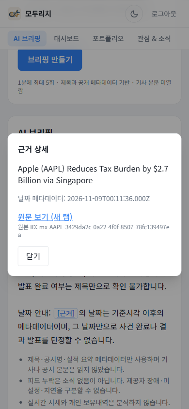
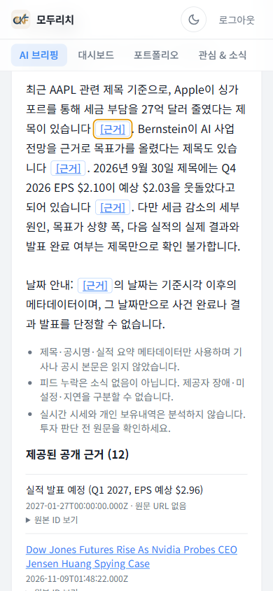

# 검토 수정본 배포 후 실제 확인

[배포 기록](review-deployment.md)의 **modu-rich-quest06-reviewed-20261109**(Next16.4.5, 트래픽100%)에서 인증된 브라우저로 새 질문3건을 실행했다. AAPL은 실제 입력폼, MSFT/NVDA는 같은 인증 세션의 API 요청이다. 질문은 운영자가 작성했으며 근거는 실제 공개 제공자 메타데이터다. 모델 호출3건 모두 HTTP200/ok였고 각 trace가 Cloud Logging의 version/revision/status와 정확히 결합됐다.

| 종목 | trace | 서버 ms | 브라우저 ms | input/output | 추정 USD |
| --- | --- | ---: | ---: | ---: | ---: |
| AAPL | 82aefa54-5f1f-46d7-a306-a9dacbc358c3 | 3876 | 4272.2 | 2979/429 | 0.0005124 |
| MSFT | a6ff2228-5406-4a1e-ae56-0bea08afa660 | 3249 | 3720.3 | 2983/461 | 0.0005288 |
| NVDA | 2159675d-389b-40a5-9de9-d1d7ec579b74 | 2424 | 2647.4 | 3125/296 | 0.0004605 |

별도 추가 비용은 **USD0.0015017**다. 로컬 평가183서비스/171모델·기존 원격6건·UI smoke1건과 분리하며, 알려진 이전 합계와 이번3건 합은 **USD0.0513667**다. 초기 provider smoke와 계정 전체 청구는 제외한다. 과거 v6 hold-out10/10을 새 의존성 그래프의 재평가라고 부르지 않는다. [안전한 세부 증거](evidence/reviewed-smoke.json).

## 실제 화면 확인

- 390px 화면에서 근거 버튼 클릭 → 출처 모달 열림 → **닫기 버튼 초기 focus**를 DOM activeElement로 확인했다. Enter로 외부 이동 없이 닫히고 근거 버튼으로 복귀했다. 다시 열어 Escape 닫기·포커스 복귀도 확인했다. 가로 넘침 없음.
- 테마 버튼이 실제로 테마를 변경하며 아이콘을 렌더했고, 원래의 기본 테마 설정으로 복구했다. 브리핑·포트폴리오 화면 console entries는 각각0이었다.
- 자동완성 실제 AAPL 검색 후 ArrowDown/Enter 선택, 목록 닫힘, 입력 지우기, 빈 필수 수량의 폼 검증을 확인했다. 기존 행 편집 열기→취소→재열기→취소가 정상 동작했다. 포트폴리오 저장·삭제·새 피드백 투표는 실행하지 않았다. 성공/실패 저장 경로는 별도 오프라인 회귀검사의 범위다.

스크린샷에는 공개 뉴스 제목만 보이며 계정 정보·보유자산은 포함하지 않았다. 한 브라우저 확인이며 교차 브라우저·실물 모바일 터치 테스트를 주장하지 않는다. 새 사람 평가나 새 독립 품질 평가를 수행한 것은 아니다.
