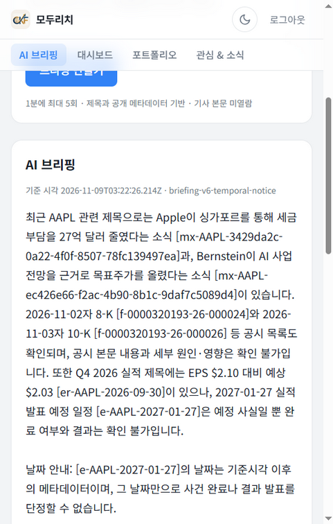
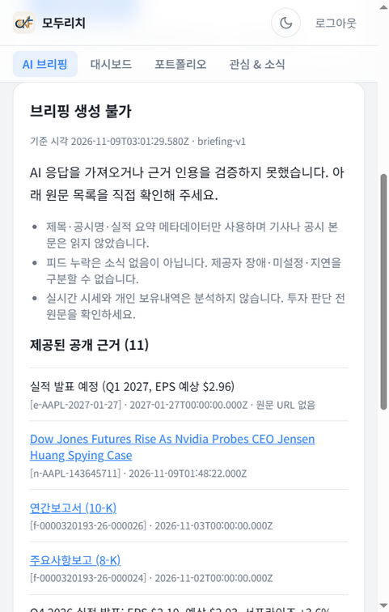

# 제출 근거·공백 감사 — 2026-11-09 중간 통합

## 최종 실측 갱신: v6 PASS·원격 양쪽 및 UI 완료, PR/독립 검토 후속

이 절이 아래 역사적 중간 상태를 대체한다. [v6 독립 평가](v6-live-evaluation.md)는40서비스37모델, 개발20/20·새 독립 hold-out v2 8/10→v6 10/10·중대0·정상회귀0으로 사전 gate PASS다. 추가 추정USD0.0095987, 로컬 누계 **183서비스171모델 USD0.0456930**이며 다른 smoke/계정 청구는 제외다. 원격은 baseline3건USD0.0020803+candidate3건USD0.0015708=**USD0.0036511**로 별도 표시한다. 알려진 로컬+원격 합USD0.0493441은 전체 계정 청구가 아니다.

[배포 보고](deployment-verification.md)는 v6 Ready/100% traffic, 실제 archive와14개 inference hash 일치, image `ed253c7921dcad7b2c8f3845a65c4dd33cb64504669a2f2b07da35a3bd2993cf`를 확인한다. [원격 문서](deployed-live-verification.md)와 [후보 CSV](evidence/deployed-candidate.csv)/[전후 JSON](evidence/deployed-comparison.json)은 baseline unavailable3/3→candidate0/3, 양쪽 trace exactjoin3/3을 검증했다. 같은 질문·새UUID·새시각이며 AAPL 근거11→12/hash변경, 나머지12→12/hash동일이다. 전체를 동일 frozen 실험으로 표현하지 않는다.

[피드백 안전 요약](evidence/deployed-feedback-summary.json)은 **운영자 기능 테스트1건**(202/accepted 후 Cloud Logging score1 read-back)과 **실제 사용자 정성 의견1건**(긴ID 대신 짧은 근거버튼 요청)을 분리한다. 숫자 만족도표로 바꾸지 않았고 메시지 도착 알림은 응답에서 제외했다. raw 사용자 문장·기사 본문·native reasoning·인증정보를 공개하지 않았다.

[최종 코드검증](final-validation.md):12스크립트/25테스트/typecheck 통과, 변경 production·새 tooling lint0; whole-repo는 확인된 기존 오류5개가 남는다. 예전 tooling lint 실패 기록은 해결 이력을 포함한 역사적 기록이며 최종 상태와 구별한다.

**현재 남은 공백:** 실제 PR 링크와 요청된 독립 Claude 검토는 코디네이터 후속이다. 최종 UI 배포·390px 브라우저 검증은 완료했고 [별도 smoke](evidence/deployed-ui-smoke.json) 1모델/input2979/output446/USD0.0005209를 전후 원격6건과 분리한다. 알려진 로컬+원격6+UI1 비용 합은 USD0.0498650이다. [공개 최종 입력·rubric·응답·판정](evidence/final-README.md)과 v1/v2 원본 소스28개가 제공되어 과거 fixture 부재 공백은 해소됐다. native 원문은 의도적으로 비공개이며 모델 재실행 답변 동일성을 보장하지 않는다. 초기 focus는 모달의 원문 링크, Escape/focus 복귀는 확인했고 DOM click만 사용했다. 아래 중간 기록의 미완료 표시는 당시 상태다.

## 아래 기록은 이전 단계의 역사적 감사

## 최신 갱신: 배포 baseline 및 v5/v6

아래 이전 통합 기록보다 이 최신 상태를 우선한다. [원격 실측](deployed-live-verification.md) 및 [CSV](evidence/deployed-baseline.csv)/[JSON](evidence/deployed-baseline.json)은 계측 baseline revision00004-72l에서 인증된 새 대화3건과 Cloud Logging exact join3/3을 확인한다. 모두200/unavailable이며 retrieval/assembly ok, generation error이다. 모델 종료 이유 원본이 없으므로 thinking/truncation 원인을 확정하지 않는다. 공개 피드 제공자 메타데이터를 조회했지만 시장 사실성을 검증한 것은 아니다.

v5는 개발20/20·정상회귀0 통과, 새 독립 hold-out은 실제 소비됐으며 v2 7/10 대비 v5 9/10·중대0이나 정상회귀1로 **FAIL**이다. 새 셋이 아직 미실행이라는 아래 문구는 v3/v4 당시 상태만 뜻한다. [v5 실제 평가](v5-live-evaluation.md)에 최종 CSV/집계가 있다. 추가40서비스37모델 USD0.0090198로 로컬 누계는 **143서비스134모델 USD0.0360943**이고 초기 smoke 제외다. 별도 원격3건은 input5803/output3000·USD0.0020803이며 로컬 누계에 섞지 않았다.

v6는 프롬프트/생성설정을 유지한 별도 서버 날짜 안내만 구현·동결했다([실험 문서](v6-temporal-notice-experiment.md)). VERSION briefing-v6-temporal-notice, artifact3ace4794db84368aa2350ada962e5d6bad4c4dcd85f21a7bdc8c9a8040742753이며 회귀/typecheck 완료, 모델0·실측 미평가다. 완전히 새로운 독립셋을 다른 평가자가 준비한다. 이전 hold-out 입력/응답을 읽어 튜닝하지 않았다.

완료 공백은 baseline 새 대화·실제 실패화면·Cloud Logging read-back이다. 남은 공백은 후보 배포 후 대응 대화3건/로그/화면, v6 독립평가, PR URL/commit 및 실제 사용자 피드백이다. Langfuse 미사용·사용자 피드백0을 유지한다. 뒤의 표와 숫자는 **v4 완료 시점의 역사적 감사 기록**으로 보존하며 현재 완료량으로 재사용하지 않는다.

## 이전 통합 기록 (v4 완료 시점)

REPORT는 완료 실측과 진행 중 작업을 분리했다. 이번 문서 통합은 공개 분석·CSV·배포 보고 및 코디네이터 관찰을 근거로 하며 원격 실행을 새로 검증한 것이 아니다. 별도 승인된 v5 최소 소스 변경은 아래와 같이 구분한다. 개인정보·키·원문 thinking/signature·개인 로컬 절대경로는 공개하지 않는다.

## 일곱 요구사항 대응

| REPORT 섹션 | 증거 | 완료·한계 | 남은 것 |
| --- | --- | --- | --- |
|1 로그 수·대화 제작|[v1/v2 CSV](evidence/q610-comparison.csv), [v3 CSV](q604-v3-development-evidence.csv), [v4 평가](v4-live-evaluation.md)|103서비스/97모델, USD0.0270745 추정; 합성30개 입력의 버전별 반복 포함|초기 smoke와 계정 청구는 별도; 실사용자 로그 없음|
|2 후보3개 이상·trace·첫 단계|[기준 분석](live-baseline-analysis.md), REPORT 실제 trace5개|독립4범주, 추출 surfaced와 잠재 후속 문제 구분|작은 합성 표본의 일반화 불가|
|3 선택 빈도·영향·비용|[v2 실험](live-baseline-analysis.md)|19/19 추출 오류를 첫 단일 수정으로 선택; 나머지는 후속 실험|작업시간·심각도 점수 실측 없음|
|4 데이터·사전 gate|[공개 입력](evidence/q610-synthetic-cases.json), [v3 평가](v3-live-evaluation.md), [v4 평가](v4-live-evaluation.md)|개발20/기존hold-out10, 새 독립셋 봉인; 9/10·회귀0 사전조건 유지|v3/v4 새 hold-out0 NOT_EVALUATED, v5 미평가|
|5 변경·전후·PR|[manifest](evidence/q610-source-manifests.json), [v3 hash](v3-contract-source-hashes.json), [v4](v4-output-experiment.md), [v5](v5-partial-evidence-experiment.md)|v2 held-out8/10 FAIL; v3 개발12/20 FAIL; v4 개발17/20이나 정상회귀 FAIL|v5 live 결과, PR URL·commit·리뷰 승인 없음|
|6 배포 후 검증·캡처|[배포 검증](deployment-verification.md), [인증폼 캡처](evidence/screenshots/baseline-authenticated-form.png)|v1 revision00003-sfx 복구200/401/403, 실제 로그인폼 관찰|후보 배포, 버전별 새 실제 대화, 응답 캡처, Cloud Logging read-back 미완료|
|7 회고·미래 사용자 피드백|REPORT7절|출력계약/단계경계/BOM/callback 등 실제 관찰한 기술 문제|실제 사용자 의견0, 요청한 설문 응답 미수신|

## 숫자 중복과 실행 상태 감사

- v1/v2:60서비스58모델 USD0.0157906.30개 입력을 두 버전에서 실행했다.
- v3:추가20서비스18모델 USD0.0072902. 비교 v2는 기존 응답을 재사용하므로 추가20을 다시 세지 않는다. 소계80/76/USD0.0230808.
- v4 pilot:동일 개발 사례3개의 별도3호출 USD0.0005843. 입력 종류는 늘지 않지만 실제 비용/호출은 늘었다.
- v4 full:추가20서비스18모델 USD0.0034094. 누계103/97/USD0.0270745; initial smokes 제외.
- v5:소스·오프라인 검증만 완료, 이 작업의 실제 모델 호출0. 다음 평가 결과는 별도 통지 뒤 반영한다.
- 모델 미호출 빈근거/명시 타종목 보류를 전체 서비스 분모에서 지우지 않는다. status=ok, 적절한 보류, 기술 fallback, 의미 통과는 같은 지표가 아니다.
- latency는 로컬 모델-backed 서비스 시간이다. Cloud Run 체감 시간이나 account bill로 바꾸지 않는다. thinking 토큰은 output의 부분집합이다.

## 실패 게이트를 보존했는가

v2 기존 held-out은9개 서비스 성공 중 날짜 오류1개와 fallback1개 때문에 품질8/10으로 실패했다. v3는 정상 가용성04/06/07/08 회귀만으로도 실패하며03의 보수적 의미 판정을 바꿔도 실패는 변하지 않는다. v4는 기술 생성 실패0이지만03의 provenance 과해석과07의 과도 보류가 정상 회귀여서 실패했다. 새 독립 hold-out은 v3/v4에서 실행하지 않았다. 미실행을0/10 정확도나 합격이라고 쓰지 않는다. v5는 filing 메타데이터 명명 제한과 부분근거 답변 규칙 두 개만 바꾸며, 실제 의미 개선은 아직 검증하지 않았다.

## 배포·관측과 아직 없는 증빙

코디네이터가 baseline 인증된 폼을2026-11-09T02:56:16Z 직접 확인하고 개인정보 없는 캡처를 저장했다. 이를 로그인 미확인으로 남기지 않았지만 모델 제출 성공으로 확장하지도 않았다. revision `modu-rich-quest06-00003-sfx`와 build복구 결과는 [배포 담당 보고](deployment-verification.md)에 연결했다. callback 로컬43검사 통과는 배포된 fix의 증거가 아니다.

Langfuse는 미사용이다. 계측-only baseline 이미지와 v4 build는 Q608 작업 중이며 완료 보고가 오기 전에는 빌드/배포/ingestion을 추정하지 않는다. 실제 Cloud Logging 저장·조회, 인증된 API 새 대화의 version/trace·usage 및 피드백 durable read-back은 미완료다. PR URL/최종commit/리뷰와 정상·문제 답변 화면 캡처도 아직 없다. 인증폼 캡처가 있으므로 모든 캡처가 없다고 쓰지는 않는다.

## 소스 정체성과 후속 갱신

각 실험 VERSION와 전체 artifact hash를 REPORT에 실었다. v1/v2의 service.ts hash가 같아도 imported adapter와 VERSION이 다르며 전체 manifest로 구별한다. v3 승인 aggregate와 실행 artifact는 hash 범위가 달라 동일값으로 오기하지 않는다. v4 설정 변경은 prompt뿐 아니라 thinking/effort/schema를 포함한 복합 실험이다. v5는 해당 설정과 서버검증을 그대로 두고 의미 지시 두 개만 변경한다.

후속 통지 시 반영할 최소 자료: Q604 실제 개발/독립hold-out 결과·실패분모·질문별 의미 판정, Q608 build/revision/image·로그 조회, 배포 뒤 인증된 새 대화와 실제 캡처, PR/commit, 실제 설문 답변 유무. 같은 사례를 다시 평가한 수와 신규 입력 수를 구별하고 기존 실패 실험은 삭제하지 않는다. 현재 문서 통합 완료가 Main Quest 전체 완료나 release 승인이라는 뜻은 아니다.
